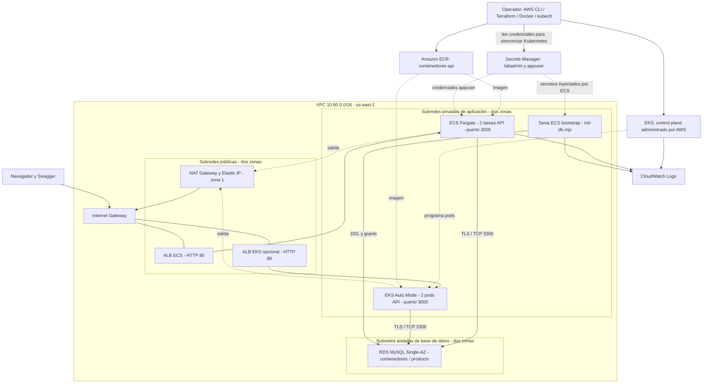

# Laboratorio de contenedores: Docker, ECS Fargate y EKS Auto Mode

API de productos con Node.js 24, Fastify y MySQL. Este proyecto permite ejecutar la aplicación en Docker Compose y publicar la misma imagen en ECS Fargate y EKS, compartiendo una base RDS privada. Incluye infraestructura Terraform, políticas IAM, manifiestos Kubernetes y scripts por etapas para Windows y Linux.

**Para alumnos:** comenzar por [docs/ALUMNOS.md](docs/ALUMNOS.md). Cada alumno usa una cuenta AWS propia y configura su cuenta, perfil, región y principal IAM en `lab.config.json`, a partir del ejemplo versionado. Los scripts y Terraform usan esa configuración. No se necesitan credenciales ni recursos del docente. Los nombres no demuestran recursos activos; al recrear cambian IDs, endpoints y secretos.

**Linux:** seguir la [guía detallada de Bash nativo](docs/LINUX.md), con equivalentes `.sh` para ECS/EKS, generación de JSON, sincronización de secretos, conexión kubectl y publicación ALB. Los scripts Linux principales ejecutan AWS CLI directamente y no requieren PowerShell ni Python.

## Índice

1. [Arquitectura](#arquitectura).
2. [Explicación de la VPC](#explicación-de-la-vpc).
3. [Requisitos y sesión](#1-requisitos-y-sesión).
4. [Ejecución local](#2-ejecutar-localmente).
5. [Terraform y RDS](#3-crear-la-red-y-la-base-de-datos).
6. [Secretos y ECR](#4-secreto-de-aplicación-e-imagen-ecr).
7. [Roles y tareas ECS](#5-preparar-iam-y-tareas-ecs).
8. [Bootstrap SQL](#6-inicializar-mysql).
9. [Servicio ECS](#7-publicar-ecs-fargate).
10. [EKS Auto Mode](#8-crear-eks-auto-mode).
11. [Desplegar Kubernetes](#9-desplegar-en-kubernetes).
12. [Explicación de todos los YAML](#explicación-de-los-yaml-kubernetes).
13. [Políticas para el commit](#políticas-iam-para-incluir-en-el-commit).
14. [Scripts](#inventario-detallado-de-scripts), [diagnóstico](#actualizaciones-rotación-y-diagnóstico), [limpieza](#limpieza-y-costos) y [commit](#preparar-el-commit).

| Carpeta | Contenido |
| --- | --- |
| `backend/` | Dockerfile, Compose, API, pruebas y OpenAPI |
| `backend/src/init-db.mjs` | Creación de tabla, usuario de aplicación y grants |
| `backend/k8s/` | Namespace, ConfigMap, Deployment y Service |
| `backend/k8s/alb/` | Ingress opcional para ALB de Auto Mode |
| `backend/scripts/` | Generadores PowerShell originales y exportador OpenAPI |
| `infra/` | Terraform: VPC, subredes, NAT, SG y RDS |
| `scripts/` | Aprovisionamiento por etapas para PowerShell y Bash |
| `policy/` | Confianzas y permisos IAM que se pueden versionar |
| `eks/` | Ayuda de conexión Windows y referencias del clúster |

## Arquitectura

GitHub muestra el siguiente gráfico Mermaid directamente en el README:



En EKS el Service ofrece una dirección interna estable y sus endpoints identifican los pods. Con targets de tipo IP, el ALB envía el tráfico a las IP de los pods. También se puede usar `kubectl port-forward` sin crear un ALB EKS. El control plane pertenece al servicio administrado de AWS; no son servidores EC2 del usuario dentro de las subredes.

En local: `localhost:3000 → API Docker → MySQL Docker + volumen`. La base local es independiente de RDS. ECS y EKS sí comparten la misma base remota: un producto creado desde uno debe verse desde el otro.

## Explicación de la VPC

Una **VPC** es una red virtual regional con direcciones privadas. Aquí hay una sola VPC `10.80.0.0/16`, compartida por ECS, EKS y RDS; no se necesita peering. Cada subred pertenece a una zona de disponibilidad. Se usan dos zonas para distribuir aplicaciones y permitir balanceadores en ambas, aunque RDS sigue siendo Single-AZ.

| Subred | CIDR | Zona de referencia | Ruta exterior | Recursos |
| --- | --- | --- | --- | --- |
| Pública 1 | `10.80.0.0/24` | us-east-1a | `0.0.0.0/0 → IGW` | ALB y NAT |
| Pública 2 | `10.80.1.0/24` | us-east-1b | `0.0.0.0/0 → IGW` | ALB |
| Aplicación 1 | `10.80.16.0/20` | us-east-1a | `0.0.0.0/0 → NAT` | Fargate y EKS |
| Aplicación 2 | `10.80.32.0/20` | us-east-1b | `0.0.0.0/0 → NAT` | Fargate y EKS |
| Base de datos 1 | `10.80.240.0/24` | us-east-1a | Solo ruta local | RDS subnet group |
| Base de datos 2 | `10.80.241.0/24` | us-east-1b | Solo ruta local | RDS subnet group |

Terraform selecciona las primeras dos zonas disponibles; consultar `terraform output availability_zones` para conocer las reales.

- **Internet Gateway:** salida/entrada de Internet para recursos con direccionamiento público. Tener una ruta al IGW no asigna una IP pública automáticamente.
- **NAT Gateway:** permite conexiones salientes desde las aplicaciones privadas para descargar imágenes y contactar AWS. No acepta conexiones iniciadas desde Internet hacia las tareas. Está en la primera subred pública y usa una Elastic IP.
- **Una NAT:** reduce recursos de laboratorio, pero crea dependencia de una zona y puede generar tráfico entre zonas. No proporciona salida multi-AZ tolerante a fallos.
- **Tablas de rutas:** pública hacia IGW, aplicación hacia NAT, base de datos sin ruta exterior. Todas tienen ruta local para la comunicación dentro de la VPC.
- **Subredes aisladas:** RDS usa las dos para su subnet group, pero la instancia está en una sola zona. No tiene IP pública ni salida por NAT. La laptop no puede llegar directamente a MySQL.
- **Etiquetas:** `kubernetes.io/role/elb=1` marca subredes públicas y `kubernetes.io/role/internal-elb=1` privadas para el descubrimiento de balanceadores EKS.
- **Security groups:** filtros con estado asociados a interfaces. El ALB admite HTTP 80 solo desde la IPv4 pública del operador `/32`; ECS admite 3000 desde el SG del ALB; RDS admite 3306 desde los SG de aplicación autorizados.
- **Auto Mode:** su SG real se obtiene de `resourcesVpcConfig.clusterSecurityGroupId`. `infra/eks-auto-mysql.tf` autoriza 3306 desde ese SG mediante una variable. Si se personalizan NodeClasses, comprobar los SG reales de sus interfaces.

IAM, red y MySQL son capas distintas: permitir leer un secreto no abre 3306; abrir 3306 no crea el usuario SQL; crear el usuario no concede acceso al secreto AWS.

## 1. Requisitos y sesión

Antes de los comandos AWS, copiar `lab.config.example.json` a `lab.config.json`, completar los 12 dígitos de la cuenta y el perfil propio y ejecutar `./scripts/setup.ps1` en Windows o `bash scripts/setup.sh` en Linux. La preparación consulta STS y disponibilidad regional RDS y genera `infra/lab.auto.tfvars.json`; no crea recursos. Si se usa una sesión SSO/rol, indicar el ARN IAM real en `operator_arn`. Ver [configuración del alumno](docs/ALUMNOS.md#5-configurar-el-laboratorio-en-un-único-archivo).

Instalar Git, Docker con contenedores Linux, AWS CLI v2, Terraform >= 1.10 y kubectl compatible con EKS. Windows usa Python >= 3.10 para `lab.ps1`. El recorrido Linux nativo usa Bash >= 4 y jq >= 1.6; no requiere Python para desplegar. El provisionador Python y su wrapper `lab.sh` siguen como alternativa. Node.js >= 24 solo hace falta para ejecutar pruebas y regenerar OpenAPI fuera de Docker.

El operador necesita permisos para aprovisionar VPC/EC2, RDS, Secrets Manager, ECR, ECS, EKS, ELB, logs e IAM, incluido `iam:PassRole` para los roles del laboratorio. Las políticas de operador incluidas son limitadas: no conceden toda esta administración. Los scripts no amplían los permisos del usuario.

Ejecutar desde la raíz del repositorio. Windows PowerShell:

```powershell
aws configure --profile laboratorio # Solo si no existe; nunca guardar claves en Git.
. ./infra/Initialize-Session.ps1
aws sts get-caller-identity --profile $env:AWS_PROFILE
terraform version
docker version
python --version
kubectl version --client
```

Linux/Bash:

```bash
aws configure --profile laboratorio # Solo si no existe.
source ./infra/Initialize-Session.sh
aws sts get-caller-identity --profile "$AWS_PROFILE"
terraform version
docker version
bash --version
jq --version
kubectl version --client
```

Confirmar el Account ID propio de `lab.config.json`. Terraform y los scripts bloquean otras cuentas. Los scripts Bash se invocan con `bash`, sin necesitar `chmod`; `.gitattributes` conserva sus saltos LF. En Windows el wrapper usa `python`; si solo existe `py -3`, adaptar esa línea o instalar Python en PATH.

`Initialize-Session.ps1` prepara la CA desde los almacenes Windows. La opción `-LocalPluginTlsWorkaround` es únicamente para el problema mTLS local de Terraform documentado en [infra/README.md](infra/README.md); HTTPS a AWS mantiene la validación. En Linux con CA corporativa configurar `AWS_CA_BUNDLE` con la cadena válida.

## 2. Ejecutar localmente

Windows:

```powershell
cd backend
Copy-Item .env.example .env # Solo la primera vez.
docker compose up -d --build
docker compose ps
Invoke-RestMethod http://localhost:3000/health/ready
cd ..
```

Linux:

```bash
cd backend
test -f .env || cp .env.example .env
docker compose up -d --build
docker compose ps
curl --fail http://localhost:3000/health/ready
cd ..
```

Editar las claves de `.env` antes de arrancar. Compose espera MySQL, ejecuta `migrate` y arranca la API; que `migrate` termine con código 0 es normal. MySQL no publica puerto en el host. Abrir [Swagger](http://localhost:3000/docs/) y crear un producto:

```json
{"name":"Teclado","description":"Demostración","price":89.90,"stock":10}
```

| Ruta | Uso |
| --- | --- |
| `/health/live` | Proceso activo, independiente de MySQL |
| `/health/ready` | 200 con MySQL disponible; 503 si falla |
| `/api/info` | Versión, entorno y hostname |
| `GET/POST /api/products` | Lista paginada y creación |
| `GET/PUT/DELETE /api/products/{id}` | Consulta, reemplazo y eliminación |
| `/docs/`, `/openapi.json` | Swagger y contrato OpenAPI |

Verificación desde `backend`: `npm ci`, `npm test`, `npm run docs`. Los tests HTTP requieren Compose activo y crean/eliminan sus productos. `docker compose down` conserva el volumen; `docker compose down -v` elimina sus datos. Cambiar `.env` no cambia la contraseña de un volumen MySQL ya inicializado.

## 3. Crear la red y la base de datos

Si existe `infra/eks-auto.auto.tfvars` de una ejecución anterior, vaciar su variable: `eks_auto_node_security_group_id = ""`. No referenciar un SG eliminado. Conservar el estado Terraform y generar planes nuevos.

Windows:

```powershell
cd infra
. ./Initialize-Session.ps1
terraform init
terraform fmt -check
terraform validate
terraform plan '-out=lab.tfplan'
# Revisar el plan: los recursos generan costo.
terraform apply 'lab.tfplan'
terraform output
cd ..
```

Linux:

```bash
cd infra
terraform init
terraform fmt -check
terraform validate
terraform plan -out=lab.tfplan
terraform apply lab.tfplan
terraform output
cd ..
```

`main.tf` crea VPC, seis subredes, rutas, NAT, EIP, SG y MySQL `contenedores-lab-mysql`: clase `db.t4g.micro`, 20 GiB gp3 cifrados, crecimiento hasta 30 GiB, Single-AZ y sin endpoint público. La versión MySQL procede de `mysql_engine_version`, seleccionada y comprobada por setup en la región del alumno.

### RDS y Secrets Manager: creación de la base

En `aws_db_instance.mysql`, `db_name="contenedores"` crea la base inicial. `username="labadmin"` define el administrador y `manage_master_user_password=true` pide a **RDS** generar y administrar su contraseña en **Secrets Manager**. No se introduce la clave maestra en variables Terraform. `mysql_admin_secret_arn` devuelve el ARN del secreto, no su valor. No crear manualmente un segundo secreto administrador.

La base inicial todavía no contiene `products` ni el usuario `appuser`: eso lo hace bootstrap. Se conserva un día de backups automatizados mientras existe RDS. Al destruir, `skip_final_snapshot=true` y `delete_automated_backups=true` eliminan la instancia y sus backups sin snapshot final. Exportar previamente datos que se quieran conservar.

| Output Terraform | Uso posterior |
| --- | --- |
| `vpc_id` | VPC de ALB y target group |
| `public_subnet_ids` | Dos subredes para ALB |
| `app_private_subnet_ids` | Tareas Fargate y EKS |
| `ecs_security_group_id` | Interfaces ECS |
| `eks_security_group_id` | Identidad de red EKS preparada |
| `mysql_security_group_id` | Reglas TCP 3306 |
| `mysql_host`, `mysql_database` | Variables de conexión |
| `mysql_admin_secret_arn` | Credenciales de bootstrap |

## 4. Secreto de aplicación e imagen ECR

Se usan **dos secretos**: el maestro de `labadmin`, administrado por RDS, y `contenedores/api/mysql`, con JSON `username=appuser` y `password` generado. El runtime recibe exclusivamente el segundo. Ambos usan cifrado de AWS; los scripts de aplicación asumen la clave predeterminada de Secrets Manager.

Windows:

```powershell
./scripts/lab.ps1 secret
./scripts/lab.ps1 image --version v1
```

Linux:

```bash
bash scripts/ecs.sh secret
bash scripts/ecs.sh image --version v1
```

`secret` reutiliza el secreto si existe sin rotar su contraseña. Si no, solicita un password aleatorio de 32 caracteres y crea el secreto. No imprime el valor. La solicitud se guarda solo en un directorio temporal del usuario, se restringe a modo 0600 en Unix y se elimina al salir; en Windows hereda la ACL del directorio temporal del usuario. No habilitar trazas que capturen su contenido.

`image` crea ECR `contenedores-api` si falta, habilita scan-on-push al crearlo, hace login por stdin y publica la imagen `linux/amd64` como `CUENTA_DEL_ALUMNO.dkr.ecr.REGION_DEL_ALUMNO.amazonaws.com/contenedores-api:v1`. Usar `v2`, `v3`, etc. para futuras publicaciones. La imagen incluye el CA público global RDS en `/app/certs/rds-global-bundle.pem`; `DB_SSL=true` activa TLS con verificación.

## 5. Preparar IAM y tareas ECS

Windows:

```powershell
./scripts/lab.ps1 prepare --version v1
```

Linux:

```bash
bash scripts/ecs.sh prepare --version v1
```

El paso lee los outputs actuales y crea/actualiza los roles `contenedores-api-bootstrap-execution` y `contenedores-api-runtime-execution`. Adjunta `AmazonECSTaskExecutionRolePolicy` y la política inline `database-secret`. Crea el log group `/ecs/contenedores-api` con retención de siete días, el clúster ECS `contenedores-lab` y registra dos task definitions:

| Tarea | Secretos | Comando | Responsabilidad |
| --- | --- | --- | --- |
| `contenedores-api-bootstrap` | appuser y labadmin | `node src/init-db.mjs` | Tabla, usuario y grants SQL |
| `contenedores-api-runtime` | Solo appuser | CMD de la imagen | API HTTP 3000 |

Ambas usan Fargate Linux x86_64, 0.25 vCPU, 512 MiB y `awsvpc`. La configuración de red deshabilita IP pública y usa subredes privadas y SG ECS. Cada tarea recibe su interfaz; la NAT permite contactar ECR y Secrets Manager.

El **execution role** lo utiliza ECS para descargar la imagen, inyectar secretos y escribir logs. Un **task role** daría permisos AWS al código de la aplicación; este backend no lo necesita porque no usa el SDK AWS. `ARN:username::` y `ARN:password::` seleccionan claves JSON al iniciar una tarea. Actualizar un secreto no modifica los procesos ya iniciados.

`backend/ecs/generated/` incluye [plantillas `*.example.json` versionadas](backend/ecs/generated/LEEME.md), con marcadores y una tabla que indica qué reemplazar. Los JSON de tareas y red sin `.example`, generados para un despliegue concreto, permanecen ignorados por Git. Se pueden generar automáticamente o copiar/completar manualmente los ejemplos. Los archivos de permisos en `policy/` se actualizan con los ARNs nuevos y sí son versionables: no contienen contraseñas.

Alternativa PowerShell original: desde `backend`, ejecutar `./scripts/Prepare-Ecs.ps1 -ImageUri $image -AppSecretArn $arn -Version v1` y seguir [backend/README.md](backend/README.md). Ese script solo genera archivos; no aprovisiona AWS. No confundirlo con `lab.ps1 prepare`, que además crea roles y registra tareas.

El equivalente Linux que solo genera JSON es:

```bash
APP_SECRET_ARN="$(aws secretsmanager describe-secret --secret-id contenedores/api/mysql \
  --profile "$AWS_PROFILE" --region "$AWS_DEFAULT_REGION" --query ARN --output text)"
bash backend/scripts/Prepare-Ecs.sh \
  --image-uri "${LAB_AWS_ACCOUNT_ID}.dkr.ecr.${AWS_DEFAULT_REGION}.amazonaws.com/contenedores-api:v1" \
  --app-secret-arn "$APP_SECRET_ARN" --version v1
```

`scripts/ecs.sh prepare` llama a ese generador y además configura roles/logs y registra tareas; no es necesario ejecutar ambas variantes. Ver [detalle Linux de entradas y salidas](docs/LINUX.md#8-generar-tareas-y-políticas-equivalente-de-prepare-ecsps1).

## 6. Inicializar MySQL

Esperar propagación IAM después de crear roles. Si se recibe `AccessDenied` inmediatamente, comprobar permisos y reintentar después de la propagación.

Windows:

```powershell
./scripts/lab.ps1 bootstrap
```

Linux:

```bash
bash scripts/ecs.sh bootstrap
```

El script arranca una tarea temporal dentro de la VPC, espera `STOPPED` y comprueba `exitCode=0`. No basta con obtener un ARN de `run-task`. Si falla, revisar `stoppedReason` y CloudWatch `/ecs/contenedores-api`, stream `bootstrap/...`.

`backend/src/init-db.mjs` se conecta como `labadmin` por TLS y ejecuta:

1. `CREATE TABLE IF NOT EXISTS products`: ID autoincremental, nombre, descripción, precio decimal, stock y fecha; precio/stock no negativos.
2. `CREATE USER IF NOT EXISTS appuser@'%'`.
3. `ALTER USER` para alinear su password con Secrets Manager.
4. `GRANT SELECT, INSERT, UPDATE, DELETE ON contenedores.*` a appuser.

No borra productos y puede repetirse secuencialmente. No lanzar dos bootstraps en paralelo. El runtime no ejecuta DDL ni recibe permisos `CREATE`, `DROP` o administración de usuarios. Crear un secreto no crea por sí solo el usuario SQL; este paso establece esa relación.

## 7. Publicar ECS Fargate

Obtener la IPv4 pública de salida del equipo y sustituir `TU_IPV4/32`. No usar la dirección privada `192.168.x.x`; con VPN la IP pública puede cambiar.

Windows:

```powershell
./scripts/lab.ps1 ecs --cidr 'TU_IPV4/32'
```

Linux:

```bash
bash scripts/ecs.sh service --cidr 'TU_IPV4/32'
```

Este paso de **primera instalación** crea SG del ALB, entrada 80 desde el operador, regla 3000 desde ALB a ECS, ALB `contenedores-api-alb`, target group IP `contenedores-api-tg`, listener HTTP 80 y servicio ECS de dos tareas. El health check consulta `/health/ready`. Espera estabilidad y muestra la URL Swagger.

No es un reconciliador: si falla a mitad de `ecs`, inspeccionar recursos parciales antes de repetirlo. AWS rechazará nombres duplicados. Terraform no administra esos objetos externos.

Comandos comunes a Windows y Linux con perfil/región de la sesión:

```text
aws ecs describe-services --cluster contenedores-lab --services contenedores-lab
aws ecs list-tasks --cluster contenedores-lab
aws elbv2 describe-target-groups --names contenedores-api-tg
aws logs tail /ecs/contenedores-api --since 10m
```

Verificar dos tareas RUNNING y targets healthy. Abrir `/docs/`, consultar `/api/info`, crear y listar productos. El listener es HTTP para la demostración; HTTPS requiere certificado ACM y listener 443.

## 8. Crear EKS Auto Mode

El recorrido principal usa **Auto Mode**, que administra capacidad de nodos, red, balanceadores y almacenamiento integrados. No crear un managed node group adicional para completar estos pasos. Los ejemplos históricos sin Auto Mode no se deben mezclar con este recorrido.

Windows:

```powershell
./scripts/lab.ps1 eks --cidr 'TU_IPV4/32'
```

Linux:

```bash
bash scripts/eks.sh create --cidr 'TU_IPV4/32'
```

El script crea roles y el clúster `contenedores-eks` con pools `system` y `general-purpose`, balanceo/almacenamiento Auto Mode, autenticación API, endpoint privado y público restringido al CIDR. AWS elige su versión Kubernetes predeterminada disponible. Consultar `aws eks describe-cluster --name contenedores-eks --query cluster.version` y usar un kubectl compatible.

Se habilitan logs `api`, `audit` y `authenticator`. Tras esperar ACTIVE, se crea una Access entry para el usuario o rol IAM indicado en `operator_arn` de `lab.config.json` y se asocia `AmazonEKSClusterAdminPolicy` con alcance de clúster. Si se cambia el operador, actualizar la configuración; el ARN STS de una sesión asumida no se usa directamente como principal IAM de una Access entry.

El script escribe `infra/eks-auto.auto.tfvars` con el SG real de EKS. Ahora autorizar su acceso MySQL mediante Terraform:

Windows:

```powershell
cd infra
terraform plan '-out=eks-mysql.tfplan'
terraform apply 'eks-mysql.tfplan'
cd ..
```

Linux:

```bash
terraform -chdir=infra plan -out=eks-mysql.tfplan
terraform -chdir=infra apply eks-mysql.tfplan
```

Revisar que el plan añada la regla 3306 del SG actual y no recree RDS. `eks` es una operación de primera instalación: si se interrumpe después de crear el clúster, consultar su estado y completar los pasos pendientes antes de repetir `create-cluster`. Las esperas CLI pueden expirar mientras AWS sigue trabajando.

## 9. Desplegar en Kubernetes

Windows:

```powershell
./scripts/lab.ps1 deploy --version v1
```

Linux:

```bash
bash scripts/eks.sh deploy --version v1
```

El script configura el contexto `contenedores-eks`, crea namespace y ConfigMap con el endpoint RDS actual, lee el secreto de appuser, lo transmite a Kubernetes por stdin, aplica Deployment/Service y espera rollout. No imprime credenciales ni guarda un YAML de Secret en el repositorio.

La sincronización de Secrets Manager a Kubernetes la realiza el operador; no es automática y el pod no recibe permisos AWS. Base64 no es cifrado: proteger el acceso RBAC al Secret y no versionarlo.

```text
kubectl --context contenedores-eks get nodes -o wide
kubectl --context contenedores-eks get nodepools
kubectl --context contenedores-eks -n contenedores get pods,svc
kubectl --context contenedores-eks -n contenedores logs deployment/productos-api --tail=100
kubectl --context contenedores-eks -n contenedores port-forward service/productos-api 8080:80
```

Mantener el túnel activo y abrir [Swagger EKS](http://localhost:8080/docs/). Consultar los productos creados desde ECS. Ctrl+C cierra el túnel sin eliminar pods.

### Aplicación manual para explicar los archivos en clase

1. Conectar mediante `bash eks/Initialize-Eks.sh` en Linux o `./eks/Initialize-Eks.ps1` en Windows, usando la configuración propia.
2. Verificar `kubectl config current-context`.
3. Editar `configmap.yaml` con `terraform -chdir=infra output -raw mysql_host` y la imagen del Deployment con la etiqueta publicada.
4. Aplicar `namespace.yaml`, después `configmap.yaml`.
5. En Windows usar `./backend/scripts/Sync-EksSecret.ps1 -AppSecretArn 'ARN_ACTUAL'`. En Linux usar `bash backend/scripts/Sync-EksSecret.sh --app-secret-arn 'ARN_ACTUAL' --context contenedores-eks`. El paso completo `bash scripts/eks.sh deploy --version v1` también incluye esa sincronización.
6. Aplicar `deployment.yaml`, `service.yaml` y esperar rollout.

No lanzar los pods antes de crear ConfigMap y Secret. Los valores de configuración del repositorio corresponden a la ejecución de referencia; el paso automático `deploy` obtiene los vigentes.

### ALB EKS opcional

Linux puede generar y aplicar los tres objetos con el CIDR y subredes actuales, sin editar IDs del YAML de referencia:

```bash
bash scripts/eks.sh publish-alb --cidr 'TU_IPV4/32'
```

Editar `backend/k8s/alb/ingress.yaml`: reemplazar `inboundCIDRs` por la IPv4 actual `/32` y `subnets.ids` por los outputs `public_subnet_ids`. Después de destruir una VPC, sus IDs de ejemplo dejan de servir.

```text
kubectl --context contenedores-eks apply -f backend/k8s/alb/ingress.yaml
kubectl --context contenedores-eks -n contenedores get ingress productos-api-public -w
kubectl --context contenedores-eks -n contenedores describe ingress productos-api-public
```

Esperar ADDRESS y targets sanos; abrir `http://ADDRESS/docs/`. Si no aparece, revisar eventos, etiquetas públicas, IAM y CRD `ingressclassparams.eks.amazonaws.com`. El controlador es `eks.amazonaws.com/alb`; no instalar otro para reconciliar este mismo Ingress.

## Explicación de los YAML Kubernetes

`apiVersion` y `kind` identifican la API y tipo de recurso; `metadata` le asigna nombre/namespace y `spec` expresa el estado deseado. `---` separa documentos dentro de un archivo.

### `namespace.yaml`

Crea `v1/Namespace` llamado `contenedores`. Agrupa configuración, Secret, Deployment, Service e Ingress de la aplicación. Evita mezclar nombres con otros proyectos, aunque un namespace no implica aislamiento de red automático. Borrarlo elimina sus recursos, pero no RDS ni el clúster.

### `configmap.yaml`

Crea `v1/ConfigMap`, nombre `api-config`, en `contenedores`. `data` contiene host/puerto/base MySQL, TLS, ruta CA, entorno y versión. Son cadenas no secretas; `DB_PORT` y `DB_SSL` están entre comillas para evitar interpretarlos como número/booleano. `envFrom.configMapRef` convierte esas claves en variables del contenedor. Cambiar este ConfigMap no cambia el entorno de un proceso existente: reiniciar el rollout.

### Secret generado `mysql-app`

Objeto `v1/Secret` tipo `Opaque` con `DB_USER` y `DB_PASSWORD`. El Deployment lo carga mediante `envFrom.secretRef`. Se crea por stdin con server-side apply, sin una copia de la contraseña en una anotación last-applied. No hay YAML de contraseñas en Git. Debe existir antes de arrancar los pods.

### `deployment.yaml`

| Campo | Explicación |
| --- | --- |
| `apps/v1`, `Deployment/productos-api` | Controlador que mantiene pods y gestiona actualizaciones |
| `replicas: 2` | Dos réplicas deseadas; no garantiza separación entre zonas |
| `selector.matchLabels` y labels del template | Coinciden en `app: productos-api` para identificar los pods |
| `revisionHistoryLimit: 3` | Conserva hasta tres revisiones anteriores para rollback |
| `RollingUpdate`, `maxUnavailable: 0`, `maxSurge: 1` | Añade un pod nuevo antes de retirar capacidad lista; necesita capacidad extra |
| `terminationGracePeriodSeconds: 30` | Tiempo de cierre tras SIGTERM para conexiones en curso |
| `automountServiceAccountToken: false` | No monta token Kubernetes; la API no usa esa API |
| `nodeSelector: linux/amd64` | La imagen amd64 no debe ejecutarse en nodos ARM del pool system |
| `runAsNonRoot: true`, UID 1000 | Ejecuta como usuario node de la imagen |
| `seccompProfile: RuntimeDefault` | Perfil seccomp predeterminado del runtime |
| `image`, `IfNotPresent` | Imagen ECR; descargar si no está local. Usar tags nuevos o digests |
| `containerPort: 3000`, nombre `http` | Puerto de la API; declararlo no lo publica a Internet |
| `envFrom` | Combina ConfigMap y Secret como variables |
| Requests CPU `100m`, memoria `128Mi` | Reserva de planificación: 0.1 CPU y 128 MiB |
| Limits CPU `500m`, memoria `256Mi` | Máximo de CPU 0.5; exceso de memoria puede producir OOMKill |
| `allowPrivilegeEscalation: false` | Impide elevar privilegios |
| `readOnlyRootFilesystem: true`, drop `ALL` | Raíz de solo lectura y sin capacidades Linux añadidas |

Las tres probes cumplen objetivos distintos:

- **startupProbe:** `/health/live`, cada cinco segundos, hasta 24 fallos: aproximadamente dos minutos de arranque. Mientras no pasa, readiness/liveness no se ejecutan.
- **readinessProbe:** `/health/ready`, cada cinco segundos, timeout seis. Si falla MySQL, el pod deja de recibir tráfico como endpoint listo; no reinicia el contenedor. El umbral de fallos por defecto es tres.
- **livenessProbe:** `/health/live`, cada diez segundos, timeout seis. Fallos sostenidos reinician el contenedor. No depende de MySQL para evitar reinicios masivos por una caída de la BD.

### `service.yaml`

Crea `v1/Service` `productos-api`, tipo `ClusterIP`. Selecciona pods con `app: productos-api`, publica puerto interno 80 y lo dirige al `targetPort: http`, nombre que resuelve a 3000. Otros pods pueden usar `productos-api.contenedores.svc.cluster.local`. Mantiene una identidad estable aunque cambien IP de pods. Este Service no crea un ALB por sí solo.

### `alb/ingress.yaml`

Contiene tres documentos:

| Recurso | Alcance | Función |
| --- | --- | --- |
| `eks.amazonaws.com/v1 IngressClassParams` | Clúster | ALB público, IPv4, targets IP, CIDR permitido y subredes |
| `networking.k8s.io/v1 IngressClass` | Clúster | Vincula `eks.amazonaws.com/alb` con los parámetros anteriores |
| `networking.k8s.io/v1 Ingress` | Namespace | Ruta `/` Prefix al Service `productos-api:80` |

`scheme: internet-facing` solicita un ALB público. `inboundCIDRs` restringe clientes; `targetType: ip` registra IP de pods. Las anotaciones fijan listener HTTP 80, health check `/health/ready`, puerto del target y respuesta sana 200. No se fija dominio: se usa el DNS del ALB. Eliminar el Ingress mientras el clúster sigue activo deja que su controlador retire el ALB.

## Políticas IAM para incluir en el commit

Una política de **confianza** determina quién puede asumir un rol. Una de **permisos** determina qué puede hacer ese rol. No adjuntar un trust como política inline de permisos. ARNs y account IDs son identificadores, no contraseñas; los ARNs de secretos se deben actualizar al recrearlos.

| Archivo o grupo | Destino | Propósito |
| --- | --- | --- |
| `01-ecr/operator-push-policy.json` | Operador de Docker | Login y push al repositorio previsto; no crea repositorios |
| `02-ecs/bootstrap-trust.json`, `runtime-trust.json` | Roles de ejecución ECS | Confianza en `ecs-tasks.amazonaws.com` |
| `02-ecs/bootstrap-execution-policy.json` | Bootstrap | ECR, logs y lectura de los dos secretos |
| `02-ecs/runtime-execution-policy.json` | Runtime | ECR, logs y solo secreto appuser |
| `ecs-task-trust.json`, `ecs-*-secrets-policy.json` | Alternativa usada por scripts | Trust común y permisos extra junto con política AWS de ejecución ECS |
| `03-eks/auto-cluster-trust.json` | Clúster Auto Mode | `sts:AssumeRole` y `sts:TagSession` para EKS |
| `03-eks/node-trust.json` | Nodos | Confianza en `ec2.amazonaws.com` |
| `03-eks/operator-connect-and-sync-policy.json` | Operador de sincronización | DescribeCluster y lectura del secreto appuser |
| `03-eks/*permissions-reference.json`, `aws-managed-*.json` | Referencia didáctica | Copias para explicación, no sustituir versiones AWS actuales |
| `04-iot-lambda-s3/` | Extensión opcional | Fuera del despliegue ECS/EKS implementado |

El rol de clúster Auto Mode usa `AmazonEKSClusterPolicy`, `AmazonEKSComputePolicy`, `AmazonEKSBlockStoragePolicyV2`, `AmazonEKSLoadBalancingPolicy` y `AmazonEKSNetworkingPolicy`. Los nodos usan `AmazonEKSWorkerNodeMinimalPolicy` y `AmazonEC2ContainerRegistryPullOnly`. Se adjuntan por ARN administrado de AWS. No aplicar al Auto Mode las referencias históricas de un clúster con managed node groups.

`AmazonEKSClusterAdminPolicy` es una política de acceso **EKS**, asociada a una Access entry; no se adjunta con `iam attach-role-policy`. La autorización de kubectl es distinta de `eks:DescribeCluster`.

Los JSON ECS completos ofrecen una alternativa a `AmazonECSTaskExecutionRolePolicy` + permisos extra de secretos. Elegir una alternativa. Los scripts usan la segunda y mantienen actualizada la copia completa para revisión. No conceder al runtime la lectura del administrador.

No hace falta `rds-db:connect`: aquí se usa usuario/password MySQL y TLS, no IAM Database Authentication. Los grants SQL y los SG no son políticas IAM. Ampliación IoT y detalles de cada escenario: [policy/ESCENARIOS.md](policy/ESCENARIOS.md).

## Inventario detallado de scripts

| Script / etapa | Entrada | Acciones y resultados |
| --- | --- | --- |
| `scripts/setup.ps1`, `scripts/setup.sh` | lab.config.json propio | Comprueban herramientas/cuenta/RDS y generan variables Terraform locales sin crear AWS |
| `infra/Initialize-Session.ps1` | Switch TLS local opcional | Exporta perfil/región/CA Windows; no crea AWS |
| `infra/Initialize-Session.sh` | `source` desde Bash | Exporta perfil/región en la terminal Linux; no modifica CA del sistema |
| `scripts/ecs.sh` | secret, image, prepare, bootstrap, service, update, status | Operaciones AWS ECS en Bash nativo; parámetros --version y --cidr según etapa |
| `scripts/eks.sh` | create, connect, deploy, publish-alb, status | Creación/despliegue Auto Mode con Bash nativo y valores actuales de Terraform |
| `scripts/lib/common.sh` | Cargado por los scripts Bash | Comprobación de cuenta, perfil explícito, CIDR /32, temporales y roles |
| `scripts/lab.ps1` | Etapa y opciones | Inicializa sesión Windows, ejecuta Python y propaga fallos |
| `scripts/lab.sh` | Etapa y opciones | Exporta perfil/región Bash, ejecuta Python 3 con manejo estricto de errores |
| `scripts/lab.py configure` | Configuración del alumno | Preparación portable y consultas previas de versión/clase MySQL |
| `scripts/lab.py secret` | Sin contraseña manual | Genera o reutiliza secreto appuser |
| `scripts/lab.py image` | `--version` | Crea ECR si falta, login por stdin, build y push amd64 |
| `scripts/lab.py prepare` | Versión y outputs Terraform | Roles, políticas, tareas ECS, logs, clúster y JSON de red |
| `scripts/lab.py bootstrap` | JSON generado | Inicia tarea SQL, espera fin y verifica código 0 |
| `scripts/lab.py ecs` | `--cidr` | SG, ALB, TG, listener y servicio Fargate |
| `scripts/lab.py eks` | `--cidr` | Roles, Auto Mode, Access entry, logs y referencia de SG |
| `scripts/lab.py publish` | --cidr | Completa y aplica el Ingress con las subredes actuales |
| `scripts/lab.py deploy` | `--version` | Kubeconfig, ConfigMap actual, Secret por stdin, Deployment/Service y rollout |
| `backend/scripts/Prepare-Ecs.ps1` | ImageUri, AppSecretArn, Version | Solo genera JSON ECS y políticas; no despliega |
| `backend/scripts/Prepare-Ecs.sh` | --image-uri, --app-secret-arn, --version | Equivalente Bash; completa los seis ejemplos y actualiza políticas sin crear AWS |
| `backend/scripts/Sync-EksSecret.ps1` | AppSecretArn y contexto esperado | Verifica contexto, lee secreto y aplica Secret; no reinicia pods |
| `backend/scripts/Sync-EksSecret.sh` | --app-secret-arn, --context | Equivalente Bash; AWS → jq → kubectl por stdin, sin archivos de password |
| `eks/Initialize-Eks.ps1` | Clúster existente | Conexión kubectl y CA de Windows; puede importar CA en CurrentUser |
| `eks/Initialize-Eks.sh` | Clúster existente | Equivalente Linux; kubeconfig y consulta de nodos con CA nativa |
| `eks/Complete-ClusterConfig.ps1` | JSON local de red/logs | Utilidad histórica de actualización secuencial; no requerida por el nuevo recorrido |
| `eks/verify_cluster.py` | Resultados locales y clúster histórico | Diagnóstico específico Windows; no validador universal de Auto Mode |
| `backend/scripts/export-openapi.mjs` | Schemas de la API | `npm run docs` exporta contrato; no crea infraestructura |
| `backend/src/init-db.mjs` | Variables DB y administrador | Crea tabla, usuario y grants; se ejecuta en la VPC |
| `scripts/test_lab.py` | Mocks, sin AWS real | Verifica bloqueo de cuenta, secretos, fallos bootstrap, CIDR y configuración Auto Mode |
| `scripts/test_linux_scripts.py` | Linux, Bash, jq y Python para pruebas | Recorre scripts nativos con AWS simulado en copias temporales y sin red |

Consultar ayuda sin acceder a AWS: `python scripts/lab.py --help` o `python3 scripts/lab.py --help`. Las etapas llaman AWS CLI con perfil explícito y JSON; no construyen comandos de shell con credenciales. No hay etapa `all`: se verifica cada fase antes de avanzar.

Ayuda del recorrido Linux nativo: `bash scripts/ecs.sh --help`, `bash scripts/eks.sh --help`, `bash backend/scripts/Prepare-Ecs.sh --help` y `bash backend/scripts/Sync-EksSecret.sh --help`. Sus comandos AWS están en los `.sh` y no llaman al provisionador Python. El procedimiento y las pruebas de integración Linux se detallan en [docs/LINUX.md](docs/LINUX.md).

Pruebas sin crear recursos: `python -m unittest discover -s scripts -p test_lab.py` (Linux: `python3`). No sustituyen un despliegue real ni comprueban permisos efectivos de la cuenta.

`secret` reutiliza el secreto; `image` publica la etiqueta; `prepare` registra una nueva revisión de tarea. `ecs` y `eks` son de primera instalación y no reconcilian fallos parciales. Si expira un waiter, revisar AWS antes de repetir creaciones. Los scripts nuevos deben verificarse en el próximo despliegue: la limpieza no los ejecuta para volver a crear recursos con costo.

## Actualizaciones, rotación y diagnóstico

Para `v2`: repetir `image --version v2` y `prepare --version v2`. ECS: `aws ecs update-service --cluster contenedores-lab --service contenedores-lab --task-definition contenedores-api-runtime --force-new-deployment`, esperar estabilidad. EKS: `deploy --version v2`, comprobar rollout y actualizar la imagen versionada del YAML.

Para rotar appuser: actualizar Secrets Manager, repetir bootstrap para cambiar MySQL, sincronizar Secret EKS y ejecutar `kubectl --context contenedores-eks -n contenedores rollout restart deployment/productos-api`; forzar nuevo despliegue ECS. Repetir `deploy` con la misma versión no garantiza restart, porque puede no cambiar el template.

| Síntoma | Revisar |
| --- | --- |
| ImagePullBackOff | Tag/URI, permisos ECR del nodo y NAT |
| Pod Pending | Selector amd64, capacidad y eventos de Auto Mode |
| CreateContainerConfigError | ConfigMap/Secret y namespace |
| Readiness 503 | RDS host, TLS, SG real, password y bootstrap |
| Target unhealthy | Puerto 3000, SG ALB→app y `/health/ready` |
| kubectl timeout | CIDR EKS, IP actual/VPN y conectividad endpoint |
| Unauthorized/Forbidden | Perfil, Access entry y política EKS |
| Error certificado Windows | CA local/intercepción; usar helper, sin desactivar validación |
| Bootstrap STOPPED con error | exitCode, stoppedReason y CloudWatch |

## Limpieza y costos

NAT, EIP/IPv4, RDS, EKS, nodos, Fargate, ALB, ECR, secretos y logs pueden generar cargos. Eliminar primero dependencias creadas fuera de Terraform. Los pasos siguientes borran los datos de laboratorio:

1. `kubectl --context contenedores-eks delete namespace contenedores` mientras EKS funciona. Esperar que el controlador retire ALB/target groups EKS y después borrar IngressClass/Params si ya no se usan.
2. Escalar ECS a cero, eliminar servicio, esperar tareas detenidas y eliminar clúster. Si fue creado por un stack de consola, eliminar el stack CloudFormation correspondiente.
3. Eliminar ALB ECS y target group. Revocar la referencia de entrada SG ECS→SG ALB antes de eliminar el SG ALB si existe dependencia.
4. Vaciar `eks_auto_node_security_group_id` en `infra/eks-auto.auto.tfvars`; ejecutar plan/apply para quitar la referencia MySQL al SG EKS.
5. Borrar managed node groups/fargate profiles si se crearon por otra ruta; borrar EKS y esperar su desaparición. Auto Mode retira sus nodos. Revisar interfaces y SG residuales exclusivos del laboratorio.
6. Desde `infra`, ejecutar `terraform plan -destroy -out=cleanup.tfplan` y `terraform apply cleanup.tfplan`. En PowerShell citar `'-out=cleanup.tfplan'`. Se borran RDS sin snapshot final, backups automatizados, secreto maestro administrado por RDS, NAT, EIP y VPC.
7. Borrar ECR `contenedores-api` con imágenes, secreto appuser, logs `/ecs/contenedores-api` y `/aws/eks/contenedores-eks/cluster`, task definitions inactivas y roles exclusivos después de desadjuntar permisos. No borrar roles de servicio compartidos de AWS.
8. Verificar las APIs AWS y `terraform state list`. Conservar estado y backup. Las APIs de etiquetas pueden mostrar temporalmente recursos ya eliminados.

No versionar estados/planes Terraform, `.tfvars`, `.env`, kubeconfigs, CA locales, binarios ni manifiestos Secret. Sí versionar Terraform fuente, lock del proveedor, ejemplo de variables, scripts, YAML, políticas y guías.

## Preparar el commit

Revisar `git status --short` y `git diff --check`. Para seleccionar el material del laboratorio, en ambos sistemas:

```text
git add README.md GUIA-ECS-EKS.md lab.config.example.json docs/ALUMNOS.md backend/certs/rds-global-bundle.pem .gitignore .gitattributes docs/LINUX.md scripts policy backend/k8s backend/scripts backend/ecs/generated/LEEME.md backend/ecs/generated/*.example.json infra/main.tf infra/outputs.tf infra/README.md infra/Initialize-Session.ps1 infra/Initialize-Session.sh infra/eks-auto-mysql.tf infra/eks-auto.auto.tfvars.example eks/README.md eks/Initialize-Eks.ps1 eks/Initialize-Eks.sh
git diff --cached --stat
git diff --cached
```

Revisar ARNs en políticas ECS después de recrear secretos. No usar `git add .` para incorporar diagnósticos sin inspección. Esta guía no ejecuta commit ni push automáticamente.

## Referencias oficiales

- [Crear EKS Auto Mode](https://docs.aws.amazon.com/eks/latest/userguide/create-cluster-auto.html).
- [ALB e IngressClassParams de Auto Mode](https://docs.aws.amazon.com/eks/latest/userguide/auto-configure-alb.html).
- [RDS y Secrets Manager](https://docs.aws.amazon.com/AmazonRDS/latest/UserGuide/rds-secrets-manager.html).
- [Secretos JSON en ECS](https://docs.aws.amazon.com/AmazonECS/latest/developerguide/secrets-envvar-secrets-manager.html).
- [Deployment Kubernetes](https://kubernetes.io/docs/concepts/workloads/controllers/deployment/).
- [Probes Kubernetes](https://kubernetes.io/docs/tasks/configure-pod-container/configure-liveness-readiness-startup-probes/).
